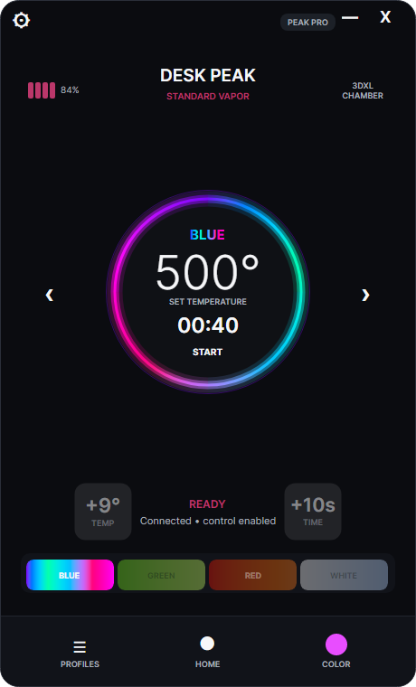

# desk_Puff

A Windows Bluetooth controller for app-enabled Puffco bases. No accounts or
cloud services.



- Device profiles, heating telemetry, session controls and boosts.
- Local heating/color JSON, with Smooth, Bold, Intense and Extreme session modes.
- Color-wheel editing, saved palettes and an idle-device handoff control.

Writes are limited to verified hardware. Current admission is Peak Pro model
13 / firmware AN; named session vapor also requires API 39, a 3DXL chamber and
successful preflight. Other firmware stays read-only. JSON session colors are
display-only; device-slot color edits have separate limits.
See [compatibility](docs/COMPATIBILITY.md) for the exact scope.

## Run

Extract the complete Windows release, keeping its `ble` and `licenses` folders.
The build is self-contained; a separate .NET installation is not required.

```powershell
.\desk_Puff.exe
```

Local profiles and preferences stay under `%LOCALAPPDATA%\desk_Puff`.
In Profiles, choose **NEW**, name the draft and **SAVE HEAT JSON**. Use
**LOAD TO EDIT** to change a saved file, or **USE FOR SESSION** followed by
**Start**. Older JSON needs an explicit named vapor choice and one save.

`--trace-writes` connects and reads normally but discards allowed writes at the
transport boundary. Simulation exists only in tests. If device state is
uncertain, hold its physical button until it powers off.

## Build

Use .NET SDK 10.0.400 and Rust on Windows 10/11:

```powershell
dotnet restore ./desk_Puff.slnx --locked-mode
dotnet build ./desk_Puff.slnx -c Release --no-restore
dotnet test ./desk_Puff.slnx -c Release --no-build --no-restore
dotnet format ./desk_Puff.slnx --verify-no-changes --no-restore
```

The Bluetooth helper is built separately. [Release instructions](docs/RELEASE.md)
cover the helper, compressed executable, notices and ZIP packaging.

## Reference

[Architecture](docs/ARCHITECTURE.md) · [Safety](docs/SAFETY.md) ·
[Protocol notes](docs/investigations/PROTOCOL-NOTES.md) ·
[Security](SECURITY.md)

Source-available under [PolyForm Noncommercial 1.0.0](LICENSE.md).
See [NOTICE](NOTICE) and [third-party notices](THIRD_PARTY_NOTICES.md).
